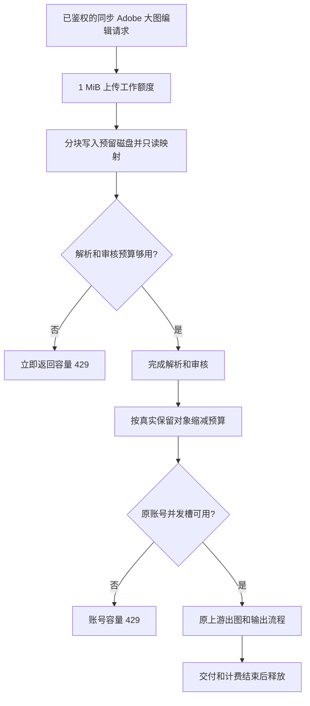

# 实际图片流量下的预留优化

10 月 16 日 12:03:28，图片预留为 7.176 / 7.2 GiB，Go 压力约 2.281 GiB，在途 346；12:05 容器实际占用约 4.11 / 12 GiB，无 OOM 或重启。同一分钟有 136 条成功业务记录、39 条本地容量 429 和 32 条显式上游 429，不能把错误列表当作全部请求，也不能只靠提高本地预算解决上游限流。

同步 Adobe `/images/edits` 的至少 1 MiB、已知长度、未压缩请求尝试预留物理磁盘，以有界 IO 直接接收上传并使用只读映射。接收阶段只持有 1 MiB 工作额度（两块 64 KiB IO 缓冲的八倍，覆盖请求/文件元数据）；读完后仍须立即取得解析/审核峰值预算（原 4 MiB + 6 倍输入，仅扣除磁盘映射的这一份原始副本），未取得则返回 429，不解析、不生成。之后只从堆预留扣除这一份映射原始副本，解码/转发副本、每张工作空间和非缓冲输出预算保持。抵扣以计入的输入字节为上限，不得抵扣工作或输出预算。文件缓存仍计入 12 GiB 容器并可回收；磁盘不可用时，在读取前重新取得原堆预算，未知长度、压缩和异步请求保持原路径。临时文件立即 unlink，直到处理结束才关闭映射。

容器 12 GiB、Go 9216 MiB、Go 压力保护约 8.1 GiB、GOMAXPROCS=6 不变；图片池由 7.2 GiB 提高到 8.1 GiB，仍为 Go 留 0.9 GiB 及容器额外 3 GiB 余量，增长前仍检查实际 Go 压力，不新增容量等待队列。上游提交在原重试后最终返回 429，账号临时避让 15 秒；已接收任务、原重试次数、Cookie/登录规则及人工状态不变。轮询/下载失败仍不重新生成。本地图片容量拒绝归为平台路由容量，不再误标认证失败；历史错误行不重写。

用户于中午确认分组 2、7 是其主动启用，要求保留现状。此要求覆盖昨天的暂停记录，不按旧审计恢复调度字段。其他账号、代理、计费、usage、安全拒绝、SMTP、告警和 Okad 功能均保留。

对照读取故障窗口 11:55–12:07 的 1,391 条脱敏大小/时序元数据，其中 813 条匹配成功耗时，其他按 180 秒占用估算。审核 JSON 大小不是 HTTP 线长；测试使用合成 multipart、JSON 内嵌图片和输出，JSON 场景保留实际 Base64 解码副本，禁网、不访问 Adobe。混合路径优先用匹配记录的缓冲标记，未知记录按 40% 非缓冲估算，时序缩放 0.15。需保留其局限，不作为真实上游吞吐保证。

发布只针对主服务器 173.234.15.150 / creative.cheap。正式流程增加 `build_only`，允许先完成全部检查和镜像构建而不替换生产容器。存在客户请求时，先由同配置临时实例接新连接，再按 Redis 请求所属进程前缀及未响应输入连接等待旧任务结束；未排空不停止容器。临时本机 NAT 规则只作用于 127.0.0.1:6666 的新连接，原连接保留，Nginx 文件不改。完成正式实例切换后撤回规则、排空临时实例并删除它。

`concurrency:rolling_deployment` 仅为有过期时间的临时运维租约：滚动期间启动清理不删除其他进程仍持有的请求槽，普通过期清理继续；租约结束恢复原启动清理，无持久配置项。审计与回退镜像在 `/opt/adobe-relay/releases/adobe-memory-real-load-20261016/`，保留旧版实际 c574dcc。回退仅恢复应用代码，保留当前业务数据和人工启用状态；检查后续版本/配置，不覆盖其他任务。

## 正式发布与验证

实际应用提交及主服务器镜像为 `c4b6bb0de3bddd982b9699355b1b3a13e8ba752b`，功能 PR #74 合并为 main `37f47dbb130a9b86d03734d0bdcc51f82b835894`。后续只改发布工具，已核对应用源码与构建提交一致。main 合并使用 `[skip ci]`，通过正式 `release.sh` 部署同一份已测镜像，避免重复替换实例。

完整后端、数据库/邮件及前端检查和镜像构建：[38857686408](https://github.com/tjt740/adobe-relay/actions/runs/38857686408)。最终禁网 Linux 对照：[38857645364](https://github.com/tjt740/adobe-relay/actions/runs/38857645364)，38 个场景全部通过，临时资源全部清理，OOM/kill 均为 0。12 GiB 场景的 cgroup 峰值最高到达 12 GiB 回收边界；1.5 GiB 场景的 32 路、每张 64 MiB 输出也全部完成。发布工具另有本地 38 项检查及主服务器隔离目录 6 项脚本模拟检查通过。

| 对照场景 | 修改前 | 新版本 | 变化 |
| --- | ---: | ---: | ---: |
| 400 路 multipart，接入数中位数 | 307 | 347 | +13.0% |
| 600 路 multipart，接入数中位数 | 299 | 405 | +35.5% |
| 400 路 JSON，接入数中位数 | 278 | 307 | +10.4% |
| 1,391 条时序 multipart，本地容量拒绝 | 226 | 73 | -67.7% |
| 1,391 条时序 JSON，本地容量拒绝 | 323 | 204 | -36.8% |

突发场景两版各运行 5 次，交替执行顺序，比较中位数。它们是相同大小/时序下的合成对照，不是上游吞吐或固定并发数保证。7.2 GiB 池的中间候选在突发对照中未达标，均未接入客户流量。

北京时间 14:21:52 临时实例接新连接；原实例连续 45 秒无请求槽和未响应输入连接后，再次于 14:30:11 完成排空核验。正式脚本完成已验证 PostgreSQL 备份和应用数据备份后替换主实例；14:35:15 新连接切回正式实例。临时实例已有请求继续运行，14:44:24 排空后移除。临时 NAT、Redis 滚动租约和心跳进程全部清理，Nginx 文件未改。

临时实例继承原网络、挂载、环境、内存限制、禁止提权和日志轮转，仅临时调整日志输出，避免两个进程同时轮转共享文件。正式切换采用 `--keep-canary-on-failure`：新主实例失败时先保留接流量的临时实例，不自动启动不支持滚动租约的旧版本。普通发布的原自动回退行为保持。

## 上线核验与剩余容量限制

配置文件、除镜像引用外的环境、Sub2 设置（含 SMTP）、专属告警规则、Okad 设置/实际容器及其他服务全部通过保留检查。容器 12 GiB、Go 9216 MiB、GOMAXPROCS=6 保持；图片池为 8.1 GiB。两站 HTTPS、实时状态流、报表策略和告警心跳正常，无新增 OOM 或重启。没有人工发送邮件或主动发起生产 Adobe 测试出图。

与实际切换备份比较，956 个账号 ID 保留。28 个代理变化均可由原故障切换事件串联解释。期间用户持续通过管理接口批量更新和检测账号，原有 Token/Cookie 刷新及成功证据恢复也继续运行。账号 #476 在 14:34:22、14:34:25 有明确的调度管理操作，保留其新状态。另有 438 条分组关联增减差异，期间管理端持续成功调用 bulk-update（分组 2 关联由 249 到 423，分组 15 由 452 到 265，分组 16 由 31 到 51）；均保留实时数据，不按旧快照恢复凭据、分组、调度或人工状态。分组 2、7 同样沿用用户当前操作，不执行批量启停或改组。

14:21:52–14:40:30 的已有业务记录中有 165 条成功记录，图片内存容量 429 为 0；仍有 384 条账号容量 429、84 条最终上游 429 记录。账号容量拒绝集中在分组 9、16，每次只有 1–4 个候选号被记录为并发已满。此类账号/上游容量不是继续提高图片内存即可消除，原账号并发上限、分组隔离和计费策略保持。后续动态数字应读最新记录，不把上述窗口当实时状态。

## 原理



磁盘不可用时在读取前重新取得原堆预算；未知长度、压缩、异步及其他平台继续走原受保护路径。文件缓存仍计入容器内存，但可由内核回收。解析、解码和非缓冲输出的预算保留，容量检查不等待。

## 审计与回退

发布标签 `release/adobe-memory-real-load-20261016` 指向实际应用 c4b6bb0de；前主干标签 `rollback/adobe-memory-real-load-20261016-before-main` 指向 3d908bc43。回退镜像 `adobe-relay:before-adobe-memory-real-load-20261016` 对应实际旧版 c574dcc0，所有既有回退镜像保持。

审计目录 `/opt/adobe-relay/releases/adobe-memory-real-load-20261016/`，含 before/after、CI 原始汇总、滚动路由与排空记录、运行/业务核验、代理审计、人工操作核对及回退保护。实际切换备份 `/opt/adobe-relay/backups/20261016T063256Z-c4b6bb0de3bddd982b9699355b1b3a13e8ba752b`。

只读回退检查已通过：

```sh
python3 /opt/adobe-relay/releases/adobe-memory-real-load-20261016/adobe-memory-real-load-release.py check-rollback
```

回退只恢复应用代码，保留当前业务数据、凭据、代理、SMTP 和人工状态，不恢复旧数据库。执行前检查后续版本和配置，并先排空相关在途任务；旧 c574dcc0 不识别滚动租约，不能在其他进程仍持有出图请求槽时启动。不要绕过保护。后续归档提交跳过重复部署，核验的 application_sha 始终填实际运行的 c4b6bb0de。
