# 代理自动择优与账号路由兜底：场景路线图

日期：2026-10-17。实现分支：`codex/proxy-resilience-20261017`。

本次状态：代码实现和本地验证完成，尚未合并、推送或部署生产。本文描述的是新版代码行为，不能作为主服务器已经生效的证明。示例数字和预览页面均为布局/测试数据。

## 可以直接对外阐述的一段话

这次把代理管理从“连不上才尝试换 IP”提升为订阅、节点和账号三层自动维护。系统会识别订阅流量耗尽、到期和链接异常，优先把正在使用的账号分配到有有效连通性证据、已确认有余量的出口；持续变慢时择优迁移，并在 IP 管理标出具体问题订阅。账号调度出现空候选时，会尝试一次有时限的代理修复和同组数据库复查；仍然不可用就返回明确原因和建议重试时间，后台继续恢复。全过程保留人工暂停、客户分组、账号并发和已提交任务，避免用频繁换 IP 或重复生成掩盖资源不足。

## 路线图

```mermaid
flowchart TD
    A[后台读取订阅余额与到期信息] --> B{订阅是否明确耗尽或到期}
    B -->|是| C[排除该订阅的新分配并在 IP 管理提醒]
    B -->|否或余额未知| D[分批检查 Adobe 网络连通性]
    C --> E[寻找其他合格出口]
    D --> E
    E --> F[已启用业务账号优先取得名额]
    F --> G[稳定延迟 成功率 当前占用综合择优]
    G --> H[保留正常绑定 有明显改善才软切换]
    I[新请求进入同组账号选择] --> J{能否选到可用账号}
    J -->|能| K[沿用原并发与生成流程]
    J -->|不能且尚未尝试上游| L[有时限的代理修复与一次数据库复查]
    L --> M{重新选到账号}
    M -->|是| K
    M -->|否| N[并发满返回429 真正无账号返回503 原因及重试提示]
    N --> O[后台继续恢复 管理端保留问题提示]
```

| 实施环节 | 本次交付 | 目的 |
|---|---|---|
| 1. 订阅识别 | 为每条订阅建立稳定标识，保存脱敏定位、流量和到期证据、失败及采集时间 | 找到“哪个订阅出了什么问题” |
| 2. 节点择优 | 余额准入、网络检查覆盖、平滑延迟、近期连接成功率、占用评分和软切换冷却 | 自动避开明确失效来源，减少频繁换出口 |
| 3. 名额分配 | 已启用业务账号优先，必要时回收暂停/异常账号的绑定名额 | 减少有健康节点却无法给业务账号分配的情况 |
| 4. 请求兜底 | 空候选时修复现有代理分配，并做一次同组数据库复查 | 避免缓存滞后或可修复的分配问题直接变成 503 |
| 5. 管理提醒 | IP 管理新增订阅状态卡片、分组候选容量、可回收名额 | 管理员能定位来源、知道是否需要人工处理 |
| 6. 验证与发布 | 本地独立 PostgreSQL、相关 race、前端回归、类型检查、构建及布局验证；生产发布未执行 | 将“代码已完成”和“线上已生效”区分清楚 |

## 具体场景

### 场景 1：订阅 A 的流量耗尽

以前：节点仍存在，可能继续被当作可用代理，直到连接失败。

现在：若服务商提供有效用量信息且剩余量为零，整条订阅 A 的节点停止参与新分配；自动分配在后续维护轮次将受影响账号迁到其他合格出口。IP 管理显示“订阅流量耗尽”、订阅序号、脱敏链接、用量记录时间和节点情况。

优先选有近期正余额证据的来源。如果只有余额未知但连接正常的来源，仍可作为保守备选，界面明确显示“剩余流量未知”。系统不会把未知余额写成有流量。

续费后取得新的有效正余额证据，订阅可以重新参与分配；链接刷新失败或缺少余额信息不会自动清除旧的耗尽结论。

### 场景 2：订阅链接打不开，但已导入的节点还能使用

现在：IP 管理显示“订阅链接更新失败”，给出 HTTP 状态或连接/下载/内容错误，并定位是哪条订阅。已有节点继续按实际连通性使用。

链接获取失败不能证明节点全坏，因此不会仅凭一次订阅拉取失败就大批解绑。如果节点也连续连接失败，原自动切换会避开它们；全部节点有有效故障证据时显示“节点全部不可达”。

### 场景 3：当前 IP 从约 700 ms 变成持续 5 秒

现在：单次测速波动不切换。连续 3 次成功网络检查均超过 2 秒，且替代节点的平滑延迟至少改善 30%、并减少至少 500 ms，才允许软切换；同一账号软切换冷却 5 分钟。

切换前仍要检查候选节点的状态、检测新鲜度和每节点 3 账号上限。不会为了单纯提速，把已确认有余量的正常来源换到余额未知的来源。硬故障、明确耗尽或到期可以绕过软切换冷却。

没有更好的候选时继续使用仍可工作的慢节点；慢不是绝对禁用条件，避免“全部慢节点被禁用后变成零候选”。切换只影响后续请求，在途任务不迁移、不重新生成。

### 场景 4：健康节点全满，但名额被暂停账号占着

示例：某节点绑定 3 个暂停/异常账号，另有 1 个已启用业务账号等代理。

现在：业务账号先分配；必要时回收一个非业务绑定名额。被回收账号的凭据、错误原因、过期设置和人工调度状态保持，后续有余量时可重新绑定。

IP 管理的自动分配面板增加“可回收名额”，避免把“没有空绑定名额”误读为完全没有可用业务容量。每节点最多 3 个账号保持，不通过提高上限挤压出口。

### 场景 5：缓存显示没账号，数据库里已有刚恢复的账号

现在：在尚未尝试上游时，尝试一次使用现有健康证据的代理分配修复，并绕过账号快照做一次数据库复查。仍然沿用同一客户分组、模型支持、人工暂停、额度、限流和账号排除条件；不会回退到全站账号。

该恢复/复查阶段总时限 1.2 秒；代理修复内部时限 200 ms，拿不到任务锁就快速退出。代理修复每进程最多约 2 秒触发一次，数据库复查每进程限 5 次/秒，并继续服从原数据库回退开关和限额。它不是等待队列，不会在请求内主动登录、抓订阅或检测 Adobe。

### 场景 6：某个账号失败，但同组还有其他合格账号

原有同组换号逻辑保持。新兜底只补充首轮无账号的修复与复查，不扩大原来的实际尝试预算。

已取得任务编号的轮询/下载继续处理原任务，沿用原有重试和下载出口回退，不重新提交生成。鉴权、额度或模型权限问题继续按原规则处理，不能用换 IP 宣称已经恢复。

### 场景 7：账号都被人工暂停，或者确实全部不可用

系统不能凭空产生合格账号，也不会偷偷启用暂停账号。

仍然无候选时返回 HTTP 503、`error.code=no_available_accounts`、明确的 `reason` 和 `Retry-After`；后台继续维护代理，管理端继续展示问题。常见原因包括空账号池、没有启用账号、等待代理、授权需要处理、暂时不可用。

如果实际是候选账号并发槽都满，保持 HTTP 429，并增加 `Retry-After: 2`。模型不支持的原 404 判断保持。重试时间是客户端建议，不是届时必定恢复的承诺。

## 检查频率与边界

- 订阅正常刷新间隔为 5 分钟，后台每分钟检查一次是否到期，因此实际约 5–6 分钟；失败按 1–15 分钟逐步退避，最多 4 条订阅同时拉取，单次 8 秒限制。
- 自动网络检查约每 30 秒一轮，最多 24 路并发、每轮 19 秒预算；新分配的证据有效期按节点规模在 45–240 秒内调整。配置改动仍要求重新检测，不能继承旧节点的成功结果。
- 剩余流量正值只在 15 分钟内作为“已确认有余量”的优先依据；过期信息显示未知。已确认的耗尽/到期证据保持，直到获得对应的新证据。
- IP 管理只读状态约每 30 秒刷新；刷新页面本身不触发 Adobe 检测、登录、出图或邮件。
- 分组容量是根据已有状态得到的候选统计；模型限制、并发、后续请求结果会进一步影响可用性。连接可达不代表账号鉴权、模型权益或出图成功。
- 不改变每节点 3 个账号、人工暂停、客户隔离、账号实际登录预算、原邮件策略和计费，不新增容量等待队列。

## 代价与限制

1. 订阅不提供用量或到期元数据时无法保证余额准确，只能明确显示未知并结合连接证据选择；后台轮询也存在检测延迟。
2. 网络检查和订阅读取有有界开销；节点数量更多时，不能把一次快照当作所有节点此刻都健康。
3. 回收暂停账号的绑定可能使其稍后再次启用时需要等待重新分配；不会自动把它启用。
4. IP 变化可能影响会话；因此保留正常绑定、软切换冷却和在途任务路径。
5. 后台刷新订阅状态，不自动增删或全量重载已导入节点；节点清单需要更新时使用原有导入入口，避免监控动作中断在途连接。
6. 新增迁移 250 只保存代理质量证据；订阅元数据保存在原配置文档。生产应用需要走正式发布流程执行迁移，本文不是部署记录。

## 本地验证与发布状态

本轮使用一次性 PostgreSQL 与合成 HTTP 订阅完成相关后端 race、数据库、86 项前端检查、类型检查和构建。未主动调用生产 Adobe、登录或发送邮件。

实现提交：`f3a465685`。记录时仍为待发布；这份文档描述新版设计，不是生产已经生效的证明。资源扩容与今晚 13 组隔离压测属于另一项已经完成的工作，详见同页压测报告。

发布前复核最新主干、数据库迁移编号及发布锁，保留现有业务数据、人工调度、已上线功能及最新资源配置。回滚恢复代码，保留当前数据。
